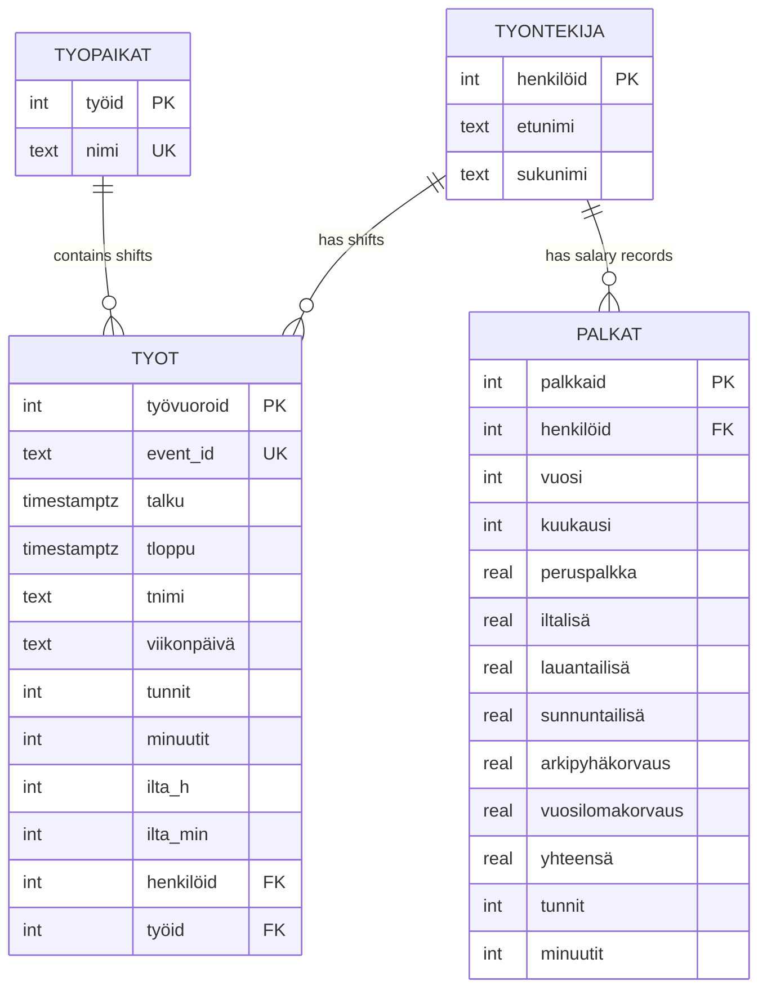

# Calendar payroll estimate

This is an ongoing project for estimating my girlfriend's monthly pay from her work shifts.

The application:

1. Pulls shift data from the Google Calendar API.
2. Transforms and cleans the data with pandas.
3. Calculates an estimated monthly wage, including applicable additions.
4. Uploads the shifts and wage estimate to a PostgreSQL database running in Docker.

## Database design

The application uses PostgreSQL to store employees, workplaces, work shifts
and monthly salary estimates. The schema separates these concerns into related
tables, which reduces duplicated data and supports SQL-based reporting.



### Relationships

- One employee can have multiple work shifts and monthly salary records.
- Each work shift belongs to one employee and one workplace.
- One workplace can contain multiple work shifts.
- `event_id` uniquely identifies a Google Calendar event and prevents duplicate
  shift records.
- `(henkilöid, vuosi, kuukausi)` uniquely identifies a monthly salary record.
- Foreign keys connect shifts and salary records to their related employee and
  shifts to their workplace.

The schema is initialized from Python using PostgreSQL DDL. The application
uses parameterized SQL queries, foreign keys, unique constraints and
`ON CONFLICT` handling to maintain data integrity and support repeatable data
imports.

## Setup

1. Create a `.env` file based on `env_example`.
2. Make sure the Google Calendar OAuth files, `credentials.json` and `token.json`, are available.
3. Install the Python dependencies:

   ```bash
   pip install -r requirements.txt
   ```

4. Start PostgreSQL:

   ```bash
   docker compose up -d
   ```

5. Run the application:

   ```bash
   python main.py
   ```

The result is an estimate for personal use, not an official payroll calculation. Keep `.env`, `credentials.json`, and `token.json` private.
